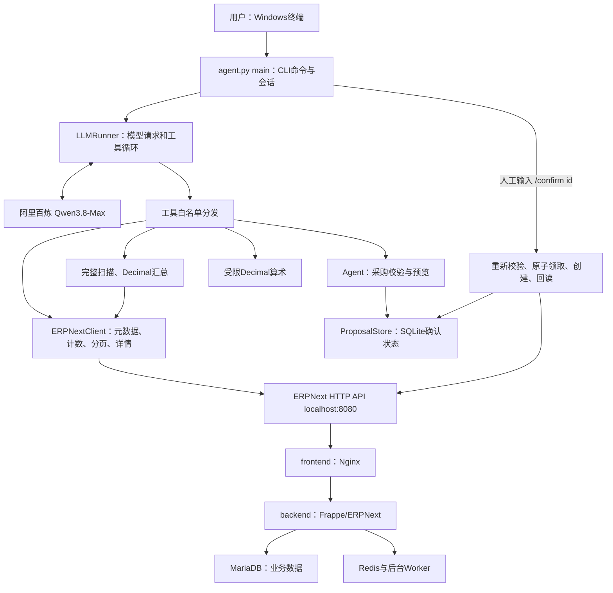

# 工核作业架构与审计说明

## 先回答：现在算不算全部做完

当前已具备可运行的本地 Agent、真实 ERPNext 环境、真实模型调用、原题问答、采购预览/确认/创建/回读、连续 Git 历史、运行说明和 write-up。CLI 符合原题 UI 要求；Pi 是推荐项，原题允许自选框架，未要求网页、多Agent、向量库或云部署。

仍有两类事项：一是 GitHub 新仓库上传与向招聘方提交链接尚未执行；二是本地验收不等于所有隐藏题和生产场景正确。本文区分“作业已实现的边界”和“尚未覆盖的能力”。

## 1. 总体结构

运行时分三处：Agent Python进程在Windows主机；ERPNext/MariaDB/Redis在Docker Linux容器；模型推理在阿里云。电脑不做本地大模型推理。computer use用于最初查看Docker配置，Agent日常运行走HTTP API。

代码采用逻辑分层，主体仍集中于 `agent.py`，持久化另在 `proposal_store.py`；没有为六小时作业拆成微服务。

## 2. Docker基础设施：原题提供，未重写

| 服务 | 职责 |
|---|---|
| frontend | Nginx，主机8080转发到Web/API |
| backend | Frappe/ERPNext Python服务，处理DocType、权限、业务校验 |
| db | MariaDB 10.6，存业务表与单据 |
| redis-cache | 缓存 |
| redis-queue | 任务队列 |
| queue-short / queue-long | 执行短/长后台任务 |
| scheduler | 计划任务进程 |
| websocket | Node Socket.IO，ERP网页实时通知 |
| configurator | 一次性写公共连接配置，成功后退出 |
| restore-site | 一次性建站、恢复seed、迁移、配置API凭据，成功后退出 |

容器通过frappe_network通信；db-data、sites、logs、redis-queue-data保存在Docker卷。Docker磁盘位于D盘；项目 `erpnext/backup` 以只读方式挂载给恢复服务。configurator和restore-site的Exited(0)是正常完成。

原始compose、备份、DATASET、原题文档保持不变。MariaDB内部读写由ERPNext完成；Agent只访问ERP HTTP API。

## 3. ERPNext数据是怎样组织的

ERPNext以DocType描述业务对象。一个DocType可理解为“带字段定义、权限和业务规则的单据类型”，不仅是数据库表。

| 业务概念 | 主要DocType及字段 |
|---|---|
| 物料 | Item，item_code、item_name、stock_uom、valuation_rate |
| 分仓库存 | Bin：一个物料/仓库组合；actual_qty、ordered_qty、各种reserved字段 |
| 采购 | Purchase Order，items子表、supplier、company、currency、docstatus |
| 客户订单 | Sales Order，items子表、customer、交付数量/状态 |
| 工单 | Work Order，required_items子表、source_warehouse |
| 物料清单 | BOM，直接用料及可能的多级展开 |
| 应收 | Sales Invoice，due_date、outstanding_amount、customer |
| 应付 | Purchase Invoice，outstanding_amount、supplier |
| 收付款 | Payment Entry，payment_type、paid_amount、received_amount、账户币种 |
| 历史库存 | Stock Ledger Entry，posting_date/time、qty_after_transaction、valuation_rate |

子表并不总能通过列表API完整读取所有字段。现在列表工具显式提示缺失字段，复杂子表优先通过父单详情读取，避免把“只返回name”误当成数量为零。

## 4. 暴露给模型的七个工具

| 工具 | 输入/输出与边界 |
|---|---|
| get_doctype_meta | 发现字段、Link/Table关系；去掉Frappe界面脚本与布局，保留真实主子表schema |
| count_documents | 按DocType/过滤计数 |
| list_documents | 指定字段、过滤、排序、分页；返回records与total/has_more/next_offset，不再只给容易误判为全量的裸列表 |
| get_document | 读取指定单据及子表 |
| aggregate_documents | 完整有界扫描，按字段分组计数、Decimal金额求和；最多10000行，重复/提前结束/缺字段/计数变化时拒绝给完整总额 |
| calculate | Decimal的加减乘除和括号；用于净额、占比、毛利。AST仅接受数字与算术，不提供eval、函数调用、变量或系统访问 |
| prepare_purchase_order | 校验供应商/物料/单位/数量/价格/日期/公司/币种，生成载荷快照与proposal-id；不创建ERP单据 |

`ERPNextClient.create`存在于Python内部，但不在模型工具白名单。模型无法调用确认、直接创建、取消、SQL或shell工具。新增只读DocType复用现有工具；新增写入类型应单独添加业务验证和确认适配器。

`aggregate_documents`输出分组金额字符串，避免二进制浮点累计误差。模型仍负责解释、分组选择和业务口径；完整扫描并不自动意味着“选对了业务过滤条件”。

## 5. 一次问答如何执行

以“铜线有多少库存”为例：

1. CLI读入文字，LLMRunner添加系统规则、参考日与工具schema。
2. Python把messages/tools发送到百炼Chat Completions接口。
3. 模型返回函数名和JSON参数，例如先查Item，再查Bin。
4. 白名单分发器调用ERPNextClient；客户端编码路径、规范过滤，并带本地ERP token请求API。
5. 工具结果以对应tool_call_id加入对话，再发给模型。模型需要多张表时可继续调用。
6. 足够证据后返回自然语言。差额/比率由calculate计算，分组汇总优先aggregate_documents。

模型不会读取本地DATASET作为答案数据。DATASET及原题只用于验收脚本的预期值。测试脚本中的固定期望数字与运行时Agent逻辑分开。

每轮最多16次模型往返，模型HTTP超时180秒，ERP HTTP默认20秒。模型空回复、截断、HTTP错误会显式报错。请求操作在历史副本上进行；整轮成功才写回会话，因此半截工具调用不会破坏下一次请求。失败轨迹保留于last_trace供验收脚本记录。

CLI支持`/reset`清对话，不会删除采购状态。长对话没有自动摘要和无限上下文管理。

## 6. 写入路径为什么要单独处理

流程为：

`自然语言 → 实时校验 → 载荷预览 → 人工 /confirm id → 再校验 → SQLite原子领取 → POST草稿 → GET回读 → 差异提示与收据`

预览确认的内容包含supplier、company、currency、transaction_date、schedule_date、item_code、qty、uom、rate和estimated_total。

- 物料必须存在、启用且可采购；供应商必须存在且启用。
- 单位使用物料stock_uom；不自动做采购单位换算。
- 数量为正，价格非负，拒绝NaN/Infinity、浮点溢出/下溢和不可表达的精度。
- 公司有且唯一时可自动选定；多公司须明确。币种固定为该公司的本位币，不悄悄做外币换算。
- 相对日期固定参考日2025-10-15；默认交易日和需求日一起传给ERPNext。
- CLI独立打印真正保存的快照，避免依赖模型是否完整复述。
- 默认预览有效期15分钟，按真实机器经过时间计时；业务参考日不会让预览永不过期。
- 确认前再查供应商、物料、公司币种，变化时拒绝沿用旧预览。
- 回读检查单据字段、明细、总额、docstatus。税费/默认值/舍入造成差异时，返回review_required与差异列表；单据保持草稿，需人工复核。

**SQLite状态**：pending → creating → completed；失败或回读异常进入failed并记录已知单号；用户可将pending改为discarded；超时预览拒绝确认。creating在网络超时/进程崩溃后保留，防止重启后再POST一次。

SQLite的BEGIN IMMEDIATE使同一本地journal的并发确认只有一个领取成功。它提供本地proposal级防重复，不是ERP服务端的全局exactly-once：两台机器各有journal、或用户重新准备新proposal时，仍需业务核对；不提供自动重试不确定写入。

只读库和主模型验证使用内存proposal，保持测试隔离；交互CLI使用 `.local/proposals.sqlite3`。`/pending`查看状态，`/discard id`撤销预览。这里撤销的是本地意图，不会取消ERP订单。

## 7. 本轮检查发现的真实问题

| 问题 | 修复/实测 |
|---|---|
| 数量超过一页时，模型可能只看20条 | 列表显式分页元数据；完整汇总工具；205行跨3页测试 |
| 模型金额减法错误 | 新题58990-57561最初答1389，正确1429；加入calculate后真实模型复测正确 |
| 进程重启后缺确认状态 | SQLite保存快照与状态；真实新进程重复确认被阻止 |
| 确认并发可能双写 | 原子领取，两个并发连接测试只有一方成功 |
| 模型调用失败残留半截消息 | 历史副本提交，失败不污染下一轮；保留诊断轨迹 |
| 预览后供应商被禁用 | 确认前重新校验；测试保证不POST |
| 公司/币种默认值不明确 | 预览固定company与currency，多公司拒绝猜测 |
| 数值有限但转成float后溢出/下溢 | 写入前检查范围/精度，阻止inf/0替代原意 |
| Python sqlite上下文不自动关闭连接 | 新测试发现Windows文件锁，改为显式关闭连接 |

本轮新建且未提交的审计草稿为PUR-ORD-2026-00029，$2,900。先前测试草稿00028仍保留，采购单总数29，已提交开放采购单仍6张、总额$15,065.50。

证据：`evidence/extended_audit.json`、`audit_write.json`、`audit_restart_replay.json`。首轮失败保留在`extended_audit_initial.json`，用于审计修复过程。

## 8. 容易在面试中被问到的业务坑

1. **业务日期与机器日期。** 题目参考日是2025-10-15；单号中的2026也不是业务日期，须看posting_date/transaction_date；发票status受2026系统时间影响，逾期须due_date < reference_date且outstanding > 0，并区分草稿/取消单据。
2. **未收回不等于逾期。** 总应收$37,720，逾期$25,380，不能混为一个指标。
3. **实物、销售预留、生产预留、在途、预测库存不同。** 200米在途尚未到货；190米预测量不是现货；预留属于本工单时不能再次重复扣减。
4. **成本口径。** Item主估值/BOM成本$575.20与实际库存成本约$566.81不同；毛利须说明售价基准和成本基准。Item Price.valid_from还有seed日期细节，不能把模型对“主数据过时”的解释当会计事实。
5. **多级BOM。** 要区分直接子装配与展开原料，不能把父层成本和子层成本再加一遍。
6. **当前快照与历史库存。** Bin是当前seed快照；问历史日期须查Stock Ledger，固定参考日不会自动做数据库时点回放。
7. **有记录/读不到/无记录。** HTTP错误、字段不支持、子表仅返回name都不能解释为零。
8. **写入超时。** 客户端没收到回复不代表ERP没创建，必须保留状态并人工对账。

## 9. 明确未做的内容

- 尚未上传GitHub或向招聘方发链接。
- 采购仅单行、公司本位币、stock_uom；未做多行、外币、税费试算和自动提交。
- 不支持自动取消/修改工单；歧义请求追问。
- 没有服务端唯一业务幂等键；SQLite保护范围是共享本机journal。
- 汇总扫描有count/重复检查，不是事务快照；扫描期间同数量记录改值仍可能影响一致性。
- 新增三道非原题检查不构成独立隐藏测试集，样例正确不代表所有自然语言都正确。
- 模型仍可能忽略工具建议或加未经验证的解释；没有对所有最终文字做形式化证明。
- 未实现生产RBAC、多租户审计、自动历史摘要和高并发服务化。当前ERP凭据遵循原题本地seed配置。

## 10. 文件与后续开发入口

| 文件 | 用途 |
|---|---|
| agent.py | CLI、模型循环、七工具、ERP HTTP客户端、采购规则 |
| proposal_store.py | SQLite确认journal与原子状态更新 |
| erpnext/ | 原题Docker与备份 |
| .env.example | 可复制的百炼默认配置，真实密钥留在被忽略的.env |
| tests/ | 单元/协议/恢复/分页/算术/并发测试 |
| verify_live.py | 真实REST、原题数据与本地写入验收 |
| verify_llm.py | 十个真实模型样例轨迹，答案仍需人工核对 |
| verify_extended.py | 新问题、完整汇总和可选单张本地草稿写入 |
| evidence/ | 分阶段原始证据 |
| README.md / WRITEUP.md | 运行说明与约一页设计取舍 |

增加新只读DocType：先meta发现字段，用列表/详情/汇总复用工具，再补一个独立问题验证。增加新写入：添加专用validator/preview/confirm适配，沿用journal，不直接把通用create暴露给模型。
