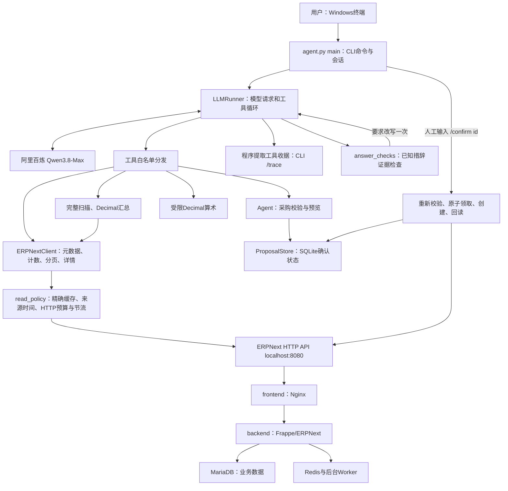

# 工核作业架构与审计说明

## 当前状态

170项代码测试通过；既有19项REST复核后又追加了真实join/币种、API效率、幂等键、上下文截止及执行轨迹检查。从非项目目录按脚本路径启动检查通过；可选`--check-model`完成Item18真实工具回路。当前八工具支持有界批量、子表join计数、报价币种、小数字面精度及客户端读复用/调用预算。

用户充值后模型API已恢复，完成完整八题复跑与定向改进：完整八题核心8/8，整段6通过、2部分；最新定向E07通过，E01不再有历史断言，但额外公式未调用calculate，保守部分。三轮“库存→缺口→采购预览”核心与载荷断言通过，第二轮额外情景公式仍部分。本轮采购单名称集合均29→29，没有新建ERP采购单；这是本地证据，不是fresh seed的运行条件。

技术选型见[TECH_REVIEW.md](TECH_REVIEW.md)，接手操作见[PROJECT_GUIDE.md](PROJECT_GUIDE.md)；新增独立十题、批量与join判分见[SCORING_REVIEW.md](evidence/SCORING_REVIEW.md)，早期复测见[FOLLOWUP_REVIEW.md](evidence/FOLLOWUP_REVIEW.md)，完整演进见AUDIT.md。历史七工具轨迹不改成八工具，真实日期与审计记录保留。

N05/N07修复见[复测记录](evidence/N05_N07_REVIEW.md)。`aggregation_checks.py`从小型完整聚合分组计算保留显式分区的rollups，并只对唯一匹配来源组的标准Markdown显式小计做数值检查，拒绝相反误差抵消；一次修正后仍错则不接受。`query_recovery.py`在同轮已观察到相同过滤的缺投影字段时，阻止重复aggregate发HTTP并给父单过滤指引。工具数/预算/采购写入流程不变，无法据此认证任意自然语言。

## 先回答：现在算不算全部做完

ce95390阶段收紧三类通用回答边界：余额不证明付款/核销历史，预留结论不超过返回字段，pending预览和拟写docstatus不冒充ERP单据状态。预览新标签会保留到收据/历史摘要；确认流程未变。见[边界复测](evidence/ANSWER_BOUNDARIES_REVIEW.md)：程序检查、AI复核与本人操作分别记录，旧R1完整回答失败，记录未改。随后日期判断修复见[日期复测](evidence/INVOICE_DATE_REVIEW.md)，本轮目标通过仍不等于整段回答全过。

当前已具备可运行的本地 Agent、真实 ERPNext 环境、真实模型调用、原题问答、采购预览/确认/创建/回读、连续 Git 历史、运行说明和 write-up。CLI 符合原题 UI 要求；Pi 是推荐项，原题允许自选框架，未要求网页、多Agent、向量库或云部署。

真实模型链路当前可用；原题与新增变式已实跑，但额外断言、公式和业务口径仍需核证。仓库上传与提交链接尚待完成；本地验收不等于所有隐藏题和生产场景正确。

## 1. 总体结构

运行时分三处：Agent Python进程在Windows主机；ERPNext/MariaDB/Redis在Docker Linux容器；模型推理在阿里云。电脑不做本地大模型推理。computer use用于最初查看Docker配置，Agent日常运行走HTTP API。

代码采用逻辑分层，主体仍集中于 `agent.py`，持久化在 `proposal_store.py`，收据和受限回答检查分别在 `tool_receipts.py` 与 `answer_checks.py`；没有为六小时作业拆成微服务。

工具定义与handler现集中于`erp_tools.py`，由`tool_registry.py`注册；Runner不再用if/elif按名字分发。每次模型请求取得Schema/handler一致视图，执行前检查工具仍启用且未被替换。默认8工具，可信代码可增删，CLI可启停；收据保留版本/effect/小数解析策略。详见[TOOL_REGISTRY](TOOL_REGISTRY.md)，注册表不提供插件沙箱或吞吐自动伸缩。

`read_policy.py`无需修改客户API：提示先缩小范围，候选列表可省略count；相同成功GET按端点/请求头指纹/路径/参数短时复用，携带读取时间，HTTP尝试按问答与滚动分钟限额计数。汇总起止检查、采购校验/回读全程回源，写尝试清缓存。每个采购预览另存稳定幂等键；支持该约定的网关可用`X-Idempotency-Key`去重，原生ERPNext不支持时仍需SQLite状态与对账。真实三轮查询→本地计算→重复计数的ERP HTTP为1→0→0，详见[API_EFFICIENCY](API_EFFICIENCY.md)。缓存不证明实时状态，也不将候选页推断成全集。自动化和K8s边界见[DEPLOYMENT_AND_AUTOMATION](DEPLOYMENT_AND_AUTOMATION.md)。

## 2. Docker基础设施：原题提供，未重写

| 服务 | 职责 |
|---|---|
| frontend | Nginx，主机8080转发到Web/API |
| backend | Frappe/ERPNext Python服务，处理DocType、权限、业务校验 |
| db | MariaDB 10.6，存业务表与单据 |
| redis-cache | 缓存 |
| redis-queue | 任务队列 |
| queue-short / queue-long | 执行短/长后台任务 |
| scheduler | 计划任务进程 |
| websocket | Node Socket.IO，ERP网页实时通知 |
| configurator | 一次性写公共连接配置，成功后退出 |
| restore-site | 一次性建站、恢复seed、迁移、配置API凭据，成功后退出 |

容器通过frappe_network通信；db-data、sites、logs、redis-queue-data保存在Docker卷。项目 `erpnext/backup` 以只读方式挂载给恢复服务。configurator和restore-site的Exited(0)是正常完成。

原始compose、备份、DATASET、原题文档保持不变。MariaDB内部读写由ERPNext完成；Agent只访问ERP HTTP API。

本机启动叠加`compose.local.yml`，替换ports为127.0.0.1/::1:8080；当前实际容器已采用该绑定。原有Nginx是反向代理入口，没有多副本高可用或独立API网关。共享HTTP策略禁止重定向、要求远端HTTPS、关闭响应并限制体积/错误输出；查询参数使用受限语法。实现与未做的权限/网络能力见[SECURITY_AND_DEPLOYMENT](SECURITY_AND_DEPLOYMENT.md)。

## 3. ERPNext数据是怎样组织的

ERPNext以DocType描述业务对象。一个DocType可理解为“带字段定义、权限和业务规则的单据类型”，不仅是数据库表。

| 业务概念 | 主要DocType及字段 |
|---|---|
| 物料 | Item，item_code、item_name、stock_uom、valuation_rate |
| 分仓库存 | Bin：一个物料/仓库组合；actual_qty、ordered_qty、各种reserved字段 |
| 采购 | Purchase Order，items子表、supplier、company、currency、docstatus |
| 客户订单 | Sales Order，items子表、customer、交付数量/状态 |
| 工单 | Work Order，required_items子表、source_warehouse |
| 物料清单 | BOM，直接用料及可能的多级展开 |
| 应收 | Sales Invoice，due_date、outstanding_amount、customer |
| 应付 | Purchase Invoice，outstanding_amount、supplier |
| 收付款 | Payment Entry，payment_type、paid_amount、received_amount、账户币种 |
| 历史库存 | Stock Ledger Entry，posting_date/time、qty_after_transaction、valuation_rate |

子表并不总能通过列表API完整读取所有字段。现在列表工具显式提示缺失字段，复杂子表优先通过父单详情读取，避免把“只返回name”误当成数量为零。

## 4. 暴露给模型的八个工具

| 工具 | 输入/输出与边界 |
|---|---|
| get_doctype_meta | 发现字段、Link/Table关系；去掉Frappe界面脚本与布局，保留真实主子表schema |
| count_documents | 按DocType/过滤计父单；显式子表join走完整扫描，按distinct父name计数 |
| list_documents | 字段/过滤/排序/分页，含name与query_scope；join时保留raw行及offset，说明本页唯一父名/重复名；Bin另带快照警告 |
| get_document | 读取指定单据及子表 |
| get_documents | 同DocType最多20个输入名，保序去重后逐项GET；回读身份校验、逐项错误/成功计数，全部成功才complete；不自动join/重试 |
| aggregate_documents | 完整有界扫描、分组计数和Decimal求和；字段去重；显式join的重复父名仅在投影一致时折叠，冲突拒绝；无join重复仍拒绝 |
| calculate | Decimal的加减乘除和括号；用于净额、占比、毛利。AST仅接受数字与算术，不提供eval、函数调用、变量或系统访问 |
| prepare_purchase_order | 显式报价currency必须匹配公司本位币，校验供应商/物料/单位/数值/日期后生成快照；不自动换汇、不创建单据 |

`ERPNextClient.create`存在于Python内部，但不在模型工具白名单。模型无法调用确认、直接创建、取消、SQL或shell工具。新增只读DocType复用现有工具；新增写入类型应单独添加业务验证和确认适配器。

`aggregate_documents`输出分组金额字符串，避免后续二进制浮点累计误差。HTTP JSON目前先按普通浮点解析，Decimal不能恢复输入阶段已丢失的极大金额精度，不能宣称任意金额均绝对精确。模型仍负责解释、分组选择和业务口径；完整扫描并不自动意味着“选对了业务过滤条件”。

批量complete只覆盖指定名称，不代表整个DocType/业务类别。部分404仍返回其他成功单据，不能称四单完整合计，但明确范围的三单小计仍有效。B01真实一调用三单成功/一单404，核心通过；模型额外泛称任何跨单据合计无效，整段部分。

## 5. 一次问答如何执行

以“铜线有多少库存”为例：

1. CLI读入文字，LLMRunner添加系统规则、参考日与工具schema。
2. Python把messages/tools发送到百炼Chat Completions接口。
3. 模型返回函数名和JSON参数，例如先查Item，再查Bin。
4. 白名单分发器调用ERPNextClient；客户端编码路径、规范过滤，并带本地ERP token请求API。
5. 工具结果以对应tool_call_id加入对话，再发给模型。发票读工具显式`assess_due_date=true`时，真实调用路径使用`invoice_due_evidence()`附加独立`reference_date_evidence`：解析日历日期、计算关系/有符号日差、用Decimal检查当前未结余额；`overdue()`共用规则。原始data/status不改，余额问题默认不附日期评估，不增加ERP读取。逐单证据进入完整工具消息、收据和历史摘要；本地持久轨迹的深层字段仍受原有截断限制。模型需要多张表时可继续调用。
6. 模型生成最终正文后经过受限证据检查；识别到已知无证据库存历史措辞时要求改写一次，再失败则报错，不接受该答案。其余正文仍需人工核证；差额/比率应调用calculate，分组汇总优先aggregate_documents。

模型不会读取本地DATASET作为答案数据。DATASET及原题只用于验收脚本的预期值。测试脚本中的固定期望数字与运行时Agent逻辑分开。

每轮最多16次模型往返，默认总时限600秒，模型HTTP超时180秒，ERP HTTP默认20秒；每次模型工具调用前和每次ERP分页/HTTP请求前都检查剩余预算。模型空回复、截断、HTTP错误会显式报错。请求操作在历史副本上进行；整轮成功才写回会话，因此半截工具调用不会破坏下一次请求。失败轨迹保留于last_trace供验收脚本记录。

CLI支持`/reset`清对话，不会删除采购状态。`LLM_CONTEXT_MAX_BYTES`按完整对话轮控制上下文；旧工具证据压成带来源时间的历史摘要，当前轮不拆分，当前完整工具轮可能临时超过预算并标记`over_budget`。采购状态仍只看SQLite。每轮脱敏执行轨迹写入`.local/traces/`，写失败不覆盖业务结果。

`tool_receipts.py`从真正的模型tool_calls和程序tool消息提取本轮收据，CLI `/trace`可查看调用参数、query_scope、记录名称、完整聚合结果、分页和错误。每轮结束显示调用/错误计数，失败轮也保留收据。查询范围只覆盖实际过滤条件；关键词命中是候选集合，不能推出整个业务类别。Bin返回值证明当前数量和位置，不能单凭仓库标签证明已经发料或转移。

`answer_checks.py`检查全对话中的已知库存历史措辞：在当前或历史Bin快照语境缺少非空事件查询证据，却声称“已发/已转”等时，要求模型修正一次；仍违规，则拒绝最终答案。空事件查询不能解除限制，规则兼顾前后置不确定表达和问句，反馈按当前库存/明确历史请求区分。它不证明非空事件的相关性，也不检查任意事实或所有算术。机制通过mock验证；最新真实定向运行没有触发修正，能说的是回答不再含该历史断言，不能说已实测触发过纠错链路。

采购工具的JSON小数参数单独使用`parse_float=Decimal`，避免在进入校验前先被Python浮点悄悄舍入；随后仍做原有范围、总额与ERP浮点可表示性检查。收据按报价小数文本保留参数。该改进针对模型报价输入，不代表ERP读响应的所有小数已无限精确。

可选`--check-model`先检查配置，再读ERP的Item计数，最后要求模型调用匹配的`count_documents`并核对实际收据；错误阶段为configuration/erp/model/tool_protocol。它验证连通与协议，不是业务正确率，也不写采购单；只有显式运行才消耗模型请求，普通CLI启动不自动调用。

## 6. 写入路径为什么要单独处理

流程为：

`自然语言 → 实时校验 → 载荷预览 → 人工 /confirm id → 再校验 → SQLite原子领取 → POST草稿 → GET回读 → 差异提示与收据`

预览确认的内容包含supplier、company、currency、transaction_date、schedule_date、item_code、qty、uom、rate和estimated_total。

- 物料必须存在、启用且可采购；供应商必须存在且启用。
- 单位使用物料stock_uom；不自动做采购单位换算。
- 数量为正，价格非负，拒绝NaN/Infinity、浮点溢出/下溢和不可表达的精度。
- 公司有且唯一时可自动选定；多公司须明确。币种固定为该公司的本位币，不悄悄做外币换算。
- 模型工具必须显式传入报价currency，并与公司本位币比较；外币报价拒绝，须明确协商本位币单价。受信Python调用保留currency=None兼容入口，不是模型可省略币种的通道。真实EUR校验已拒绝且未生成预览/采购单。
- 相对日期固定参考日2025-10-15；默认交易日和需求日一起传给ERPNext。
- CLI独立打印真正保存的快照，避免依赖模型是否完整复述。
- 预览保存规范化ERP端点与凭据配置指纹，确认时必须一致；更换端点/凭据或旧预览没有绑定时要求重新准备。日志不保存凭据原文；这不是对同地址背后远端站点身份的完整证明。
- 默认预览有效期15分钟，按真实机器经过时间计时；业务参考日不会让预览永不过期。
- 确认前再查供应商、物料、公司币种，变化时拒绝沿用旧预览。
- 回读检查单据身份、字段、明细、总额、docstatus。税费/默认值/舍入或外部状态变化时，返回review_required与差异列表；本程序不自动提交或修改，需人工复核。

**SQLite状态**：pending → creating → completed；失败或回读异常进入failed并记录已知单号；用户可将pending改为discarded；超时预览拒绝确认。creating在网络超时/进程崩溃后保留，防止重启后再POST一次。

SQLite的BEGIN IMMEDIATE使同一本地journal的并发确认只有一个领取成功。它提供本地proposal级防重复，不是ERP服务端的全局exactly-once：两台机器各有journal、或用户重新准备新proposal时，仍需业务核对；不提供自动重试不确定写入。

只读库和主模型验证使用内存proposal，保持测试隔离；交互CLI使用 `.local/proposals.sqlite3`。`/pending`查看状态，`/discard id`撤销预览。这里撤销的是本地意图，不会取消ERP订单。

加载、按ID查询、pending、confirm、discard和reconcile都限定当前连接绑定，SQLite修改事务内再次核对。修复前只有confirm防误写，共享journal仍可见/丢弃其他连接预览；该缺口已由14项作用域测试覆盖。它不是SaaS登录或文件级权限隔离。

新增`/reconcile id`仅对creating/failed的已记录单号GET回读，失败保留状态与单号；成功通过状态/名称比较更新结果，差异要求复核。未知单号不重发、不自动搜索相似单据认定成功。完整断线分支、记忆/检索/路由/租户取舍见[RECOVERY_AND_DESIGN](RECOVERY_AND_DESIGN.md)。仍没有 ERPNext 服务端业务幂等存储和持久聊天检查点；客户端预览幂等键与透传仅在对端支持该约定时具备服务端去重效果。

## 7. 2026-10-16检查发现的真实问题（历史）

| 问题 | 修复/实测 |
|---|---|
| 数量超过一页时，模型可能只看20条 | 列表显式分页元数据；完整汇总工具；205行跨3页测试 |
| 模型金额减法错误 | 新题58990-57561最初答1389，正确1429；加入calculate后真实模型复测正确 |
| 进程重启后缺确认状态 | SQLite保存快照与状态；真实新进程重复确认被阻止 |
| 确认并发可能双写 | 原子领取，两个并发连接测试只有一方成功 |
| 模型调用失败残留半截消息 | 历史副本提交，失败不污染下一轮；保留诊断轨迹 |
| 预览后供应商被禁用 | 确认前重新校验；测试保证不POST |
| 公司/币种默认值不明确 | 预览固定company与currency，多公司拒绝猜测 |
| 数值有限但转成float后溢出/下溢 | 写入前检查范围/精度，阻止inf/0替代原意 |
| Python sqlite上下文不自动关闭连接 | 新测试发现Windows文件锁，改为显式关闭连接 |

本轮新建且未提交的审计草稿为PUR-ORD-2026-00029，$2,900。先前测试草稿00028仍保留，采购单总数29，已提交开放采购单仍6张、总额$15,065.50。

证据：`evidence/extended_audit.json`、`audit_write.json`、`audit_restart_replay.json`。首轮失败保留在`extended_audit_initial.json`，用于审计修复过程。

## 8. 容易在面试中被问到的业务坑

1. **业务日期与机器日期。** 题目参考日是2025-10-15；单号中的2026也不是业务日期，须看posting_date/transaction_date；发票status受2026系统时间影响，逾期须due_date < reference_date且outstanding > 0，并区分草稿/取消单据。
2. **未收回不等于逾期。** 总应收$37,720，逾期$25,380，不能混为一个指标。
3. **实物、销售预留、生产预留、在途、预测库存不同。** 200米在途尚未到货；190米预测量不是现货；预留属于本工单时不能再次重复扣减。
4. **成本口径。** Item主估值/BOM成本$575.20与实际库存成本约$566.81不同；毛利须说明售价基准和成本基准。Item Price.valid_from还有seed日期细节，不能把模型对“主数据过时”的解释当会计事实。
5. **多级BOM。** 要区分直接子装配与展开原料，不能把父层成本和子层成本再加一遍。
6. **当前快照与历史库存。** Bin是当前seed快照；问历史日期须查Stock Ledger，固定参考日不会自动做数据库时点回放。
7. **有记录/读不到/无记录。** HTTP错误、字段不支持、子表仅返回name都不能解释为零。
8. **写入超时。** 客户端没收到回复不代表ERP没创建，必须保留状态并人工对账。
9. **额外解释也要证据。** 本轮新题的数量、金额虽正确，WIP库存来源历史、“无回款”、采购发票默认到期日、连续单号范围等附加断言并未得到相应查询证明，完整回答只能判部分通过。

## 9. 明确未做的内容

- 尚未上传GitHub或向招聘方发链接。
- 采购仅单行、公司本位币、stock_uom；未做多行、外币、税费试算和自动提交。
- 不支持自动取消/修改工单；歧义请求追问。
- 没有 ERPNext 服务端唯一业务幂等存储；每个预览已有稳定客户端幂等键并可透传给支持该约定的网关，SQLite保护范围仍是共享本机journal。
- 汇总扫描有count/重复检查，不是事务快照；扫描期间同数量记录改值仍可能影响一致性。
- 新增三道非原题检查不构成独立隐藏测试集，样例正确不代表所有自然语言都正确。
- 模型仍可能忽略工具建议或加未经验证的解释；没有对所有最终文字做形式化证明。
- 当前模型API可用，但查询范围提示与受限措辞门禁不保证一般事实正确；额外公式未按要求调用calculate仍是已知边界。
- 未实现生产RBAC、多租户审计、自动历史摘要和高并发服务化。当前ERP凭据遵循原题本地seed配置。

## 10. 文件与后续开发入口

| 文件 | 用途 |
|---|---|
| agent.py | CLI、模型循环、八工具、截止/上下文控制、只读协议检查、ERP HTTP客户端、采购规则 |
| context_budget.py / execution_trace.py | 完整轮上下文预算、历史证据摘要和best-effort脱敏执行轨迹 |
| BUSINESS_ACCEPTANCE.md | 未知DocType流程、负面状态区分、数字/口径/附加事实的人工验收标准 |
| http_transport.py / query_policy.py | 共享HTTP安全策略和有限查询语法；不替代ERP权限 |
| erp_tools.py / tool_registry.py | 内置工具就近注册Schema/handler，运行时发现、启停、移除和旧视图拒绝 |
| compose.local.yml | 覆盖主机端口为IPv4/IPv6回环，原题栈文件不变 |
| proposal_store.py | SQLite确认journal与原子状态更新 |
| tool_receipts.py | 从实际工具调用/结果生成可检查收据，不把模型自述当证据 |
| answer_checks.py | 已知库存历史措辞门禁：一次修正，再失败拒绝；非通用真值验证 |
| erpnext/ | 原题Docker与备份 |
| .env.example | 可复制的百炼默认配置，真实密钥留在被忽略的.env |
| tests/ | 单元/协议/恢复/分页/算术/并发、真实ask截止/上下文/轨迹测试 |
| verify_live.py | 真实REST、原题数据与本地写入验收 |
| verify_llm.py | 十个真实模型样例轨迹，答案仍需人工核对 |
| verify_extended.py | 新问题、完整汇总和可选单张本地草稿写入 |
| verify_variants.py / review_cases.json | 8个独立业务变式、预期与运行轨迹；不是招聘方官方保密题 |
| verify_conversation.py | 三轮真实会话、引用上轮缺口生成预览、载荷断言与未写检查 |
| scoring_cases.json / batch_case.json / join_case.json | 独立H01—H10规格；开发定向B01/J01规格，不混入独立十题通过率 |
| evidence/ | 分阶段原始证据 |
| README.md / WRITEUP.md / TECH_REVIEW.md / PROJECT_GUIDE.md | 运行、设计取舍、技术复核与接手学习 |

增加新只读DocType：先meta发现字段，用列表/详情/汇总复用工具，再补一个独立问题验证。增加新写入：添加专用validator/preview/confirm适配，沿用journal，不直接把通用create暴露给模型。

## 11. 独立审查与后续真实复测

早期开发检查由主审和3个独立审查子Agent协作，运行时仍是单模型工具循环。当前170项代码测试覆盖聚合参数、预览目标、收据、查询范围、回答检查、批量、币种、join及HTTP复用/限额、幂等键/长任务边界；真实验证分阶段保留。

本轮两项实质修复：一是重复的`sum_fields`以前可能把一个金额加两次，现已校验并去重；二是本地持久预览以前没有绑定ERP环境，现已绑定端点和凭据配置指纹。`/trace`与列表`name`补充了审查证据，但没有把LLM文本变成完全确定的程序输出。

最初八题保留在`variants_initial.json`：3通过、4部分、1额度阻断。用户充值后完整复跑`variants_followup.json`核心8/8、整段6通过2部分；E01仍有无凭证历史与公式，E07把关键词候选当成类别全集，不能算完整正确。

增加query_scope/Bin警告后的`variants_refined.json`中E07通过、E01仍部分；增加受限回答检查后的`variants_checked.json`中E01不再有历史断言，但130+100附加公式未调用calculate，保守仍部分，E07通过。该运行没有触发门禁，修正与拒绝机制由mock测试验证。

`conversation_check.json`真实完成三轮：Stores现货130 Nos/在途100→目标180、用calculate得缺口50→引用上轮50 Nos、单价USD4.20生成USD210预览。核心与载荷断言通过；第二轮附加在途情景公式未调用工具，整段部分。所有这些复测的采购单集合保持29→29。完整人工分级由AUDIT及证据记录维护，不能将不同定向运行拼成“最新完整八题全过”。

## 12. 扩展性与评分复核补充

H01—H10为旧七工具下的新独立基线，核心10/10、整段7通过3部分。H08未来FX公式的单价/总额口径含混，H09把Payment Entry查询范围外事实概括为分文未收，H10未查Company.abbr即补CCM；H06/H07额外算式仅记纪律问题，不当作核心错误。随后接口复核另发现H06显式子表过滤重复父单风险；最终分级与复核结论由[SCORING_REVIEW](evidence/SCORING_REVIEW.md)统一说明。

显式child join可能让一张父发票出现两行。内部`ERPNextClient.count`仍提供API原始行计数用于分页；模型的`count_documents`和聚合则按distinct父name。聚合完整扫描raw行，保留matched_rows/duplicates_collapsed；只有显式join且同父name所有请求投影字段值和类型一致才折叠，投影冲突拒绝，未声明join的重复仍拒绝。列表不静默去重，total/offset/next_offset维持raw_join_rows，另给本页唯一父名数量和重复名，以免丢失子行语义。

真实ERP复核已得到raw_count=2、工具distinct=1，聚合count=1/matched_rows=2/duplicates_collapsed=1/USD6600，列表标明raw分页与唯一父名1，见`evidence/join_and_currency_live.json`。J01模型也正确报告raw2/unique1、父金额6600，并调用calculate校验行金额而不重复累计，核心与整段通过。这不代表自动支持任意关联：需要子行金额应读明细，不能把不同子行投影硬折叠。J01/B01均为开发定向案例，不计独立十题通过率；B01核心过但额外概括过头，整段部分。
