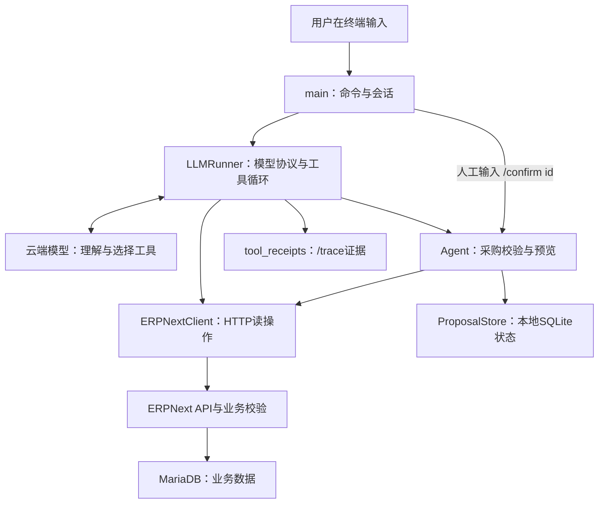
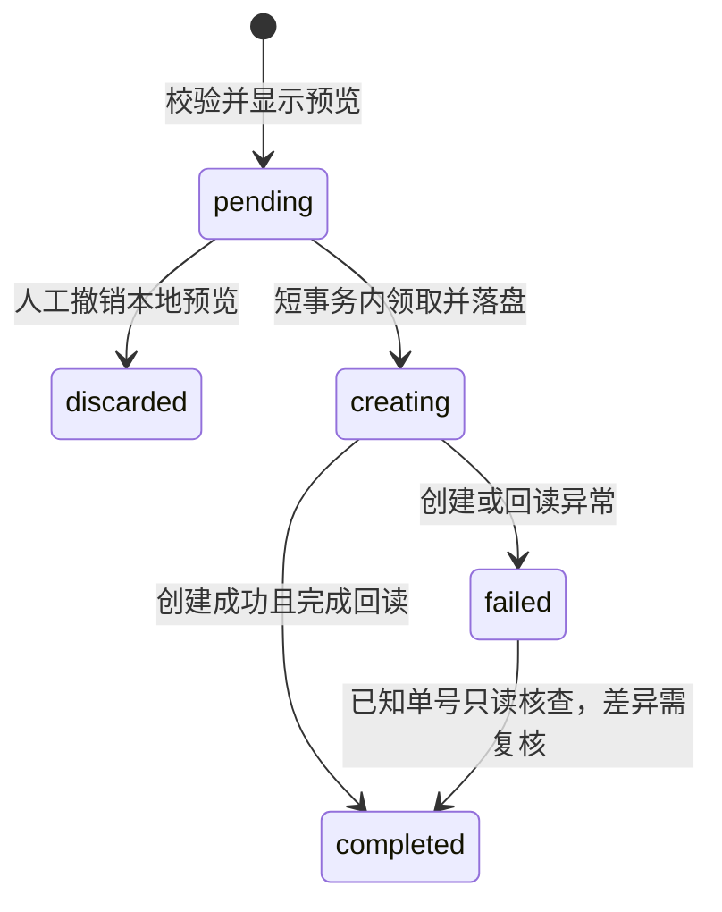

# 项目接手与学习指南

> **阅读提示（2026-10-18）：**本指南是详细的工程学习资料，包含历史阶段的代码数量和测试成绩，并非最新发布公告。当前已合并 `main-v2` 基线 **190/190**，另有未合并代码 PR #4（`3636ddb2`，**234/234** 离线回归）和文档 PR #5。最新同 SHA **60题独立真实模型首次评测已经完成：核心55/60（91.7%）、完整50/60（83.3%）、ERP写入0次**；以前单题H08存在过保守拒答，但本轮统一60题H08为PASS/PASS，两份历史证据都保留。首次评审请优先阅读 [简明 README](README.md)、[一页 WRITEUP](WRITEUP.md) 和 [版本化评测矩阵](EVALUATION_EVIDENCE.md)；以下旧数字保留其原始阶段语境，不应引用为最新 SHA 成绩。

这份指南面向第一次接手项目的人。仓库已公开并已提交评审，默认分支 `main-v2`，这份文档整理时的基线 SHA 为 `2d6ce5c1b3c4a95f6d6ddbe6b640c76aaab4a800`（实际交付版本以 `main-v2` 当前 HEAD 为准）；原应用验收基线为 `5fe679e`，当前默认分支已合入只读明细统计及快照一致性修复（源功能合并提交 `e6d0ffd`），并通过 190 项 GitHub Actions 离线回归。历史真实业务评测保留对应旧 SHA 的结论。先读 [README](README.md) 的完整启动、三个演示与验收摘要，再读 [WRITEUP](WRITEUP.md) 的六项设计说明，最后按下表走读代码。

原应用基线的全新克隆验证为 170 项测试、248 项子测试通过，`--demo` 成功；当前增强版由 GitHub Actions 验证 190 项离线回归全部通过。开发复测见 [N05/N07记录](evidence/N05_N07_REVIEW.md)；独立报告文件已核实存在且尚未纳入仓库，位置及结论见 [README](README.md)。历史 N05/N07 独立首测只覆盖两题，不能与旧版另八题拼接成同一版本的 10/10；F01/F02 未覆盖。用户已亲自完成库存、跨轮计算、日期查询及采购预览，不代表用户验证过确认写入或全部案例。下文历史阶段的未验收措辞保留其原语境；旧版分级见 [SCORING_REVIEW](evidence/SCORING_REVIEW.md)，完整演进见 [AUDIT](AUDIT.md)。

题目已经提供可恢复的 ERPNext 和业务数据，所以这份作业无需从零开发 ERP。我们实现的是 ERP 之上的问答与受控采购 Agent。代码规模可以比较小，但库存、账期、BOM、成本和不确定写入的业务边界需要仔细验证。

面试追问“用户API不能频繁调用”时，结合[API_EFFICIENCY](API_EFFICIENCY.md)理解：先缩范围/字段，再复用有时间与覆盖范围的证据，本地计算派生值；用HTTP预算/节流控制真实调用。缓存不代表实时状态，完整汇总与采购校验/回读必须回源。面试追问“生产化/幂等/K8s”时，结合[DEPLOYMENT_AND_AUTOMATION](DEPLOYMENT_AND_AUTOMATION.md)：当前有客户端幂等键和恢复边界，但没有声称ERPNext原生服务端exactly-once；K8s只有在多副本、队列和持久化运维需求出现后才引入。

## 1. 建议阅读顺序

| 顺序 | 阅读内容 | 读完应能回答的问题 |
|---|---|---|
| 1 | [README](README.md) | 当前能否真实问答？怎样启动？哪些步骤会写 ERP？ |
| 2 | [原题](ORIGINAL_README.md) | 评分标准、六小时约束、交付物和留出题到底是什么？ |
| 3 | [数据说明](erpnext/DATASET.md) | 业务参考日是什么？单号、业务日期和系统日期为什么不一致？ |
| 4 | 本指南的第 3—8 节 | 谁理解问题、谁访问 ERP、谁控制写入？ |
| 5 | [agent.py](agent.py)、[erp_tools.py](erp_tools.py) | 客户端、状态机与模型循环，以及Schema和工具函数如何一起注册 |
| 6 | [tool_registry.py](tool_registry.py)、[proposal_store.py](proposal_store.py)、[tool_receipts.py](tool_receipts.py)、[answer_checks.py](answer_checks.py) | 能力如何增删？状态如何保存？哪些证据/措辞会被检查？ |
| 7 | [tests](tests/)、[验证脚本](verify_live.py) | 哪些机制有自动验证？哪些自然语言结论仍须人工判断？ |
| 8 | [架构说明](ARCHITECTURE.md)、[技术复核](TECH_REVIEW.md)、[WRITEUP](WRITEUP.md) | 为什么这样设计？哪些地方尚有边界？面试时如何解释？ |

`DATASET.md` 是学习和验收的资料，不是运行时查答案的知识库。正常问答应从真实 ERP API 取得证据，不能把说明文档里的数字直接背给用户。

业务正确性验收标准见[BUSINESS_ACCEPTANCE](BUSINESS_ACCEPTANCE.md)：未知DocType必须完成自然语言问题、字段/关联发现、查询、口径核验和有来源回答；空结果、404、权限错误、查询错误和部分读取要分别处理。关键数字、派生计算、参考日期、公司、币种、单位、状态和库存/金额口径逐项复核；没有证据的附加事实要删除或降级完整回答。

ce95390阶段三类回答边界实测见[ANSWER_BOUNDARIES_REVIEW](evidence/ANSWER_BOUNDARIES_REVIEW.md)，158项程序通过时仍发现R1日期错误、R3否定范围歧义。后续[日期复测](evidence/INVOICE_DATE_REVIEW.md)保留旧失败，最终163项程序通过、日期/余额目标通过，但完整回答仍部分，本人操作验证尚未执行。预览的`local_state=pending`属于本地journal，`doc.docstatus`属于拟写载荷，`erp_document=null`仅说明本次预览没有创建对应ERP单据。

## 2. 最小运行：先建立自己的操作经验

在项目根目录打开终端，即能够看到 `agent.py` 与 `erpnext/` 的目录。下列命令不依赖某台电脑的固定磁盘位置；Linux/macOS 若使用 `python3`，替换命令中的 `python`。

### 第一步：启动 ERP

```text
docker compose -f erpnext/compose.yml -f compose.local.yml up -d
docker compose -f erpnext/compose.yml -f compose.local.yml logs -f restore-site
```

首次恢复等待 `Restore complete.`；已有站点可能显示跳过恢复。`Ctrl+C` 退出日志查看，不是删除站点。用浏览器打开 [本地 ERPNext](http://localhost:8080)，本地 seed 账号见 README。

启动时保留`-f compose.local.yml`：它覆盖原全网卡ports，只绑定IPv4/IPv6回环，要求Compose2.24.4+。`http_transport.py`统一出站URL、禁止重定向、响应限额与错误遮蔽；`query_policy.py`限制字段/排序/过滤语法。两者不提供租户鉴权，seed管理员权限仍需生产化时收紧，详见[SECURITY_AND_DEPLOYMENT](SECURITY_AND_DEPLOYMENT.md)。

### 第二步：确认配置位置

只在项目根目录尚无 `.env` 时复制样例；已有配置不覆盖：

Windows PowerShell：

```powershell
Copy-Item .env.example .env
```

Linux/macOS：

```bash
cp .env.example .env
```

随后在本机编辑根目录 `.env`。主要配置包括：

| 配置 | 作用 |
|---|---|
| `LLM_API_KEY` | 模型服务凭据 |
| `LLM_BASE_URL`、`LLM_MODEL` | 模型服务入口与模型名称，须匹配服务商 |
| `ERPNEXT_URL` | Agent 访问 ERP 的地址 |
| `ERPNEXT_API_KEY`、`ERPNEXT_API_SECRET` | ERP API 凭据，题目已提供本地 seed 配置 |
| `REFERENCE_DATE` | 业务参考日，作业保持 `2025-10-15` |

根目录 `.env` 是 Agent 配置；`erpnext/` 内可能存在的 Compose 配置属于 ERP 部署，两者用途不同。密钥不写入代码、文档或提交历史。

### 第三步：从轻到重检查

```text
python agent.py --demo
python agent.py --check
python agent.py --check-model
python agent.py
```

- `--demo`：加载程序入口，不请求 ERP 或模型，不能证明业务链路正确。
- `--check`：请求 ERP 物料计数，并检查模型配置字段是否存在；不调用模型，不能证明余额、权限、模型名称和模型回答可用。
- `--check-model`：可选真实API检查，会消耗额度；按配置→ERP→模型→工具协议分阶段诊断，要求实际Item计数工具收据匹配，非凭模型自称成功。已在本地约5秒完成Item18回路，不代表业务正确率。
- 正常 CLI：输入问题后才发生真实模型请求。模型调用可能消耗账户额度；实时可用状态以 README 和实际响应为准。

先问：

```text
铜线目前有多少实物库存、在途和生产预留？请分别列出单位和仓库。
```

再输入 `/trace` 查看实际证据。暂时不要从“创建订单”开始学习。

## 3. 全系统的职责地图



这里的 `Agent`、`ERPNextClient`、`LLMRunner` 是同一个 Python 进程里的三个类，并非三个模型或三项微服务。

| 代码角色 | 负责什么 | 不负责什么 |
|---|---|---|
| `ERPNextClient` | 认证、URL 编码、HTTP 请求、过滤、元数据、计数、列表、详情、完整聚合，以及内部创建接口 | 不理解自然语言，不决定用户是否已批准采购 |
| `Agent` | 校验采购参数、保存预览、确认前复验、创建草稿、回读比较、撤销本地预览 | 不负责大模型推理；它的类名比整个应用的“Agent”概念更窄 |
| `LLMRunner` | 组织 messages/tools、请求模型、分发白名单工具、将结果回传、管理本轮轨迹与成功后的会话历史 | 不允许模型调用未列出的函数，不提供模型确认或任意写入工具 |

辅助职责中，`main()` 管理 CLI 与人工命令；`ProposalStore` 管理 SQLite 状态；`tool_receipts` 提取实际证据，`answer_checks` 检查已知库存历史措辞。ERPNext 及 MariaDB 是业务数据的权威位置，模型在云端推理，电脑本地无需运行大模型。

## 4. 九个工具：通用读取、证据计算与专用采购预览

这是默认集合，可以变化。工具Schema与同步handler位于`erp_tools.py`，使用装饰器一起注册；Runner每次模型请求发现当前工具视图，再由同一注册记录执行。`agent.TOOL_DEFS`只是兼容导出，不是运行时控制入口。先用`/tools`、`/tools disable calculate`、`/tools enable calculate`观察变化；它们不消耗模型额度。新增工具、移除、会话隔离和并发变更语义见[TOOL_REGISTRY](TOOL_REGISTRY.md)。

模型得到的是函数名称、说明和参数 schema；实际执行由 Python 分发器完成。模型不能因为在回答中写出某个函数名，就任意执行系统代码。

| 工具 | 适用问题 | 重要边界 |
|---|---|---|
| `get_doctype_meta` | “这个单据有哪些字段？明细子表是什么？” | 返回字段与关联，不是业务记录；可用来发现新 DocType |
| `count_documents` | “符合条件的父单有几张？” | 显式子表join按distinct父name计；过滤决定口径，不能把join行数当单据数 |
| `list_documents` | “列出符合条件的发票/订单” | 含name、query_scope、分页；join保留raw行/offset，另给唯一父名和重复名；关键词不是类别全集 |
| `get_document` | “读取这张工单或订单的完整内容” | 包含父单及子表，适合获取 BOM、工单用料、订单行 |
| `get_documents` | “读取这几张单据，检查各自明细” | 同DocType最多20个输入名，保序去重、逐项成功/错误；部分失败complete=false，不自动join/重试 |
| `aggregate_documents` | “按客户排名、按供应商汇总未付余额” | 完整有界扫描；显式join的同父名仅在投影一致时折叠，冲突拒绝；非事务快照 |
| `calculate` | “差额、占比、净额、毛利是多少？” | 只支持受限算术，不运行任意 Python，不访问 ERP；输入数字仍须来自正确证据 |
| `summarize_details` | “从已读取的父单子表统计数量、金额和加权单价” | 仅使用本轮真实读取证据，不增加 ERP HTTP；同一父单快照冲突拒绝，完整性仍取决于上游父单名单是否完整 |
| `prepare_purchase_order` | “准备一张采购单” | 只校验和生成一个待确认预览，不创建 ERP 单据 |

通用的读接口可复用到新的单据类型，但不会自动理解所有业务定义。新写操作通常需要新的专用校验与确认适配。不能为图省事把通用 `create`、SQL 或 Shell 暴露给模型。

批量父单读取是减少模型编排往返的增强，不是已有单张读取错误。B01一调用三单成功、一单404，核心通过；额外把所有跨单据合计都说成无效，整段部分。正确边界是不能称四单完整合计，明确范围的三单小计仍可算。complete只覆盖给定名称，不证明读全某类单据。H01—H10独立基线和B01开发定向验收分开统计。

子表过滤可能使一张父发票匹配两行。列表的raw分页保持这两行，不能直接把`total=2`说成两张发票；计父单用count/aggregate。聚合要求显式join语法、重复name的投影完全一致才折叠；不同子行值不一致时拒绝，应读取父单明细。列表不静默丢行，也不自动替你猜父子关联。

`docstatus` 常用于区分草稿、已提交、已取消（分别为 0、1、2）。比如统计已经生效的财务单据，通常应明确 `docstatus=1`，然后再确定余额字段、币种和公司口径。

## 5. 一次模型问答如何逐步执行

以“铜线有多少库存”为例，下列是可能的执行过程，不要求每次模型都调用完全相同的工具：

1. CLI 把用户文字交给 `LLMRunner.ask()`。Runner 复制当前对话历史，加入系统规则、业务参考日与用户问题。
2. Runner 向模型发送 messages 和当前注册表启用的工具定义（当前默认9个；原基线8个）。系统规则指导模型查实时数据、区分现货/在途、不要凭空解释。
3. 模型可能返回 `tool_calls`，例如先用列表找到物料，再查询相应 `Bin`。这里返回的是工具名称与 JSON 参数，还没有执行 ERP 操作。
4. `_tool()` 只识别白名单中的名称，调用 Client 或 Agent。HTTP 成功、参数错误、无数据是不同情况。
5. Python 将结果包装为 `ok/data` 或 `ok/error`，以对应的 `tool_call_id` 放回 messages。
6. Runner 再次请求模型。模型可以根据结果继续查字段、读详情，或用 `calculate` 计算差额。
7. 模型不再请求工具、返回非空正文时，先经过受限的 `evidence_issues()`。如果命中已知无证据库存历史措辞，要求模型改写一次，再失败则拒绝该答案；否则本轮结束。成功历史才写回会话；异常保留失败轨迹，不把半截工具协议提交为下一轮正常历史。

一轮用户问答可能包含多次模型请求，也可能在一次模型回复中出现多个工具调用。默认最多 16 轮模型往返、总时限600秒；模型HTTP超时180秒，ERP请求超时20秒，工具执行、聚合分页和每次ERP请求都会检查剩余时间。历史按`LLM_CONTEXT_MAX_BYTES`分完整对话轮裁剪，旧工具结果带来源时间的历史摘要，不拆assistant tool_calls与tool结果；当前完整工具轮过大时会标记`over_budget`并要求缩小问题。上限用于控制循环，不表示任何问题都应查询到上限。

**应牢记：系统提示是行为指导，不是对回答的形式化证明。** 当前代码不会自动证明最终每句话都由工具结果推出。`temperature=0` 也不意味着模型永远给出完全相同且正确的答案。因此仍需要案例验收和证据审阅。

受限门禁会看全对话的工具证据，空的事件查询不能充当转料凭证；明确不确定表达和问句不应被当成已完成事件。即使读到非空事件，也不代表门禁证明了事件相关性。它只识别已知文字类型，不能替代业务判断或检查所有公式。一次修正/再失败拒答由 mock 验证；真实定向检查没有触发修正，不能说它已在实模演示中纠错成功。

## 6. 亲手用 `/trace` 核对证据

问完一个业务问题后输入：

```text
/trace
```

它显示最近一轮模型交互真正发生过的工具调用，包括参数、成功或错误，以及摘要。数据来自实际 `tool_calls` 和 `tool` 消息，程序不会根据模型正文编造收据。

按下面顺序检查：

1. **查对对象了吗？** 看 `doctype`、物料代码、客户名称、单号、过滤条件。
2. **口径完整吗？** 看 `query_scope` 的实际过滤和字段；例如未付余额是否用 `outstanding_amount`，已提交是否过滤 `docstatus`，日期边界是否正确。名字含“铜”的候选列表不能证明包含所有铜料。
3. **结果完整吗？** 列表看total_basis/has_more/next_offset，join的total是raw行而非父单数；聚合看count/matched_rows/duplicates_collapsed/complete；批量看每项ok及error_count/complete。外层工具ok不代表批量每项都成功，404不能当零。
4. **有没有算术证据？** 差额和比率可看 `calculate` 的表达式与结果，避免模型自行心算。
5. **回答有没有越过证据？** 当前库存不能独自证明材料的历史来源；未结清不能直接证明没有回款；单据不存在也不能证明所有单号连续。

收据是摘要：列表显示范围、名称、raw分页和警告；批量显示成功名称、失败项和完整性，非所有明细；详情摘要主要是单据身份。Bin警告说明仓库不是历史凭证，少数计划字段不构成通用projected_qty公式。完整字段看验证轨迹history或ERP单据；聚合与算术收据保留相应结果，报价小数参数保留文本。不要因为收据出现一个单号就认为其所有相关断言均已证明。

每轮还会把脱敏轨迹写入被Git忽略的`.local/traces/<turn_id>.json`，记录工具ID/名称/版本、参数、成功或错误、耗时、证据来源、HTTP请求和缓存时间、结束原因以及模型usage；服务商没有返回usage时记录`unknown`，不估算。轨迹写失败只记在内存诊断中，不覆盖原始业务错误或采购状态。

`/trace` 只展示最近的**模型轮**。人工 `/confirm` 走独立命令分支，确认结果应看 CLI 输出的创建/回读 JSON、已知单号与本地状态，不能把此前模型收据误当成 POST 创建的审计记录。失败后也可以用 `/trace` 查看已执行到哪里。

## 7. 采购预览、人工确认和 SQLite 状态

### 7.1 预览保存了什么

`prepare_purchase_order` 会检查供应商、物料可采购性、数量、单价、单位、日期、公司与本位币，然后生成短 `proposal_id`。保存内容包括：

- 实际准备提交的 `doc`，以及深拷贝快照；
- 行金额估算 `total`；
- `pending` 状态和创建时刻；
- ERP 端点与凭据配置指纹，用于发现预览后更换配置的情况。

CLI 独立打印实际快照，即使模型省略了载荷也能审阅。默认预览有效期 15 分钟。此时 ERP 中没有新增采购单。

模型采购工具必须明确报价currency；即使公司本位币是USD，也不能把EUR29直接理解成USD29。币种不匹配会拒绝，应先协商明确本位币报价，不自动FX。受信Python调用允许currency=None仅为兼容，不代表模型可省略。报价JSON小数先用Decimal保留字面，再检查范围和ERP浮点可表示性，避免校验前先舍入；收据保留报价小数文本。这个输入处理不等于ERP读取金额都无限精确。

### 7.2 具体确认为何必须在预览之后

只有人工输入当前预览的命令，才进入实际写入：

```text
/confirm 实际显示的proposal_id
```

不要把占位文字原样输入。自然语言“我提前确认所有方案”不能替代对这份具体载荷的审阅。模型工具中没有 `confirm`，也没有直接创建、提交或取消单据的工具。

确认阶段先检查状态、有效期和目标配置，再实时复验供应商、物料、公司及币种。然后原子领取，创建草稿，保存已知单号，最后 GET 回读字段、明细、金额和草稿状态。有税费、默认值或其他差异时，结果会包含 `review_required` 与差异列表，不自动提交。

### 7.3 SQLite 的原子领取怎样防重复

交互 CLI 注入 `.local/proposals.sqlite3`；隔离测试可以不给 `Agent` 注入存储，仅使用内存。SQLite 在这里保存本机确认状态，不保存 ERP 的权威业务数据。



过期仍可能保留 `pending` 记录，但确认会拒绝；没有单独的 `expired` 状态。进程崩溃时也可能停在 `creating`，不能假定远端没有创建。

`ProposalStore.claim()` 用 `BEGIN IMMEDIATE` 包住读取状态、检查 pending/有效期、更新 creating。事务提交后才 POST。两个进程如果共享同一文件并确认同一个 ID，只能有一个成功领取；ERP 网络请求不放在 SQLite 长事务里等待。

如果 POST 响应丢失，程序会保留 failed/creating 与已知单号，拒绝盲重试。拿到单号后 GET 失败，错误信息会提示该单可能已经创建。先对账，不要删除日志或重新生成相同订单来“试一下”。

### 7.4 本地防重复与 ERP 全局幂等的差别

| 情况 | 当前覆盖范围 |
|---|---|
| 同一电脑重启后再次确认同一个已处理 ID | 本地持久状态阻止 |
| 两个进程共享同一本地文件，同时确认同一个 ID | 原子领取阻止其中一个 |
| 预览后改 ERP 地址或凭据 | 配置绑定检查拒绝旧预览，需重新审阅 |
| 两台电脑各有日志，准备相同采购 | 没有全局保证，需中心状态与业务幂等设计 |
| 用户重新准备另一个 ID，内容恰好相同 | 不是同一确认记录，仍须业务核对 |
| ERP 已创建但网络响应丢失 | 阻止盲重试并保留状态；不能仅凭客户端超时判定是否成功 |

真正的跨客户端幂等，通常需要 ERP 服务端唯一业务键/约束与对账机制。更换本地数据库本身不能解决所有分布式不确定性。

### 7.5 已知单号的恢复核查

`/reconcile 实际ID`仅接受creating/failed且已保存created_name的记录，只GET原单并复用回读核对；不执行POST，也不凭相似订单推断成功。未知单号、其他连接、未绑定旧记录会拒绝。网络仍失败时保留failed与名称；完成后通过状态/单号比较更新，避免覆盖并发结果。其他连接的预览也不能被pending显示或discard修改。这是连接配置隔离，还没有应用租户登录权限。

系统没有持久聊天恢复、长期画像、向量库或多模型路由；现在每轮另有被忽略的脱敏执行轨迹，history按完整轮做低依赖预算和历史证据摘要。四类记忆、JSON规划、错误恢复顺序与生产化方案详见[RECOVERY_AND_DESIGN](RECOVERY_AND_DESIGN.md)，其中标明当前实现与后续设计。

N05/N07追加记录见[复核](evidence/N05_N07_REVIEW.md)：`computed_rollups`提供小型完整分组的本地分区小计，`/trace`可看显式表格小计核算。缺字段后重复聚合会在HTTP前停止；查明细应先用父单上的子DocType条件收窄、再读去重父单。检查只覆盖可匹配的标准表格，不等于任意文字证明，ERP请求预算不变。

## 8. 日期与业务口径：这部分不能随便清理

**作业参考日 `2025-10-15` 必须保留。** 清理打包文件名或本机路径，不意味着修改业务日期、真实审计时间或 Git 历史。

| 日期或状态 | 正确理解 |
|---|---|
| 参考日 `2025-10-15` | 题目定义的“今天”；相对日期、逾期判断默认依此解释 |
| 机器当前日期 | 不用于替代题目参考日；会影响 ERP 某些派生状态 |
| 单号里的年份 | 命名序列的一部分，不等于单据实际业务日期 |
| `posting_date` / `transaction_date` | 应读取的业务发生日期，不从单号猜测 |
| `due_date` / `schedule_date` | 到期日/需求日，作用不同，不能混用 |
| 预览 `created_at` 与 15 分钟 TTL | 按真实经过时间计算，不能因为业务参考日固定而永久有效 |
| Git 提交、验证轨迹的时间 | 真实开发与审计记录，保留其历史含义 |

“逾期应收”通常需要：已提交、`outstanding_amount > 0`，且 `due_date < 2025-10-15`。未付款不一定已逾期；机器显示的 `Overdue` 可能与题目参考日不一致。模型询问逾期时，三个发票读工具可显式启用`assess_due_date=true`，程序把原始status与`reference_date_evidence`分开：before/on/after分别表示参考日前/当天/之后，到期当天不算逾期。余额问题默认不开评估；`/trace`可核对程序证据与读取来源。缺失字段为未知，不能把原始status当计算替代。

采购默认同时明确 `transaction_date` 与 `schedule_date`。如果让交易日默认成机器当前日期、需求日却传题目日期，会触发 ERP 的先后关系校验。保留参考日是为了满足题目数据语境，不是为了伪造机器时间。

类似地：现货、生产预留、销售预留、在途和预测库存是不同字段；毛利必须说明售价及成本基准；多级 BOM 不应同时把半成品与展开后的原料重复累计；历史库存不能只靠当前 Bin 回答。

## 9. 第一天建议亲手完成的实验

每个实验都先讲出“准备验证什么”，做完再看证据。这里以读和预览为主，避免学习时反复产生测试单据。

### 实验 A：分清三种检查

依次运行 `--demo`、`--check`、正常 CLI。解释为什么前两者成功仍不能证明模型可用。再运行：

```text
python -m unittest discover -s tests -v
python verify_live.py
```

前者检验代码机制，后者请求真实ERP；原应用基线的170项代码测试通过，当前增强版由GitHub Actions验证190项离线回归，既有19项REST又追加join/币种验证。两者均不能自动证明模型文字正确。后续数量看当次输出，不要把测试项数当正确率。想明确验证模型协议，可额外运行`--check-model`，它会消耗API额度。

### 实验 B：铜线库存与证据

问现货、在途和生产预留，再 `/trace`。在原始 seed 中，公开核对点为现货 50 米、在途 200 米、生产预留 60 米；如果数据已变化，应查实际记录而不是强行让答案匹配样例。解释为什么不能把在途直接加成现货。

### 实验 C：对照两个财务问题

先问“所有未收回的销售发票余额”，再问“截至作业参考日的逾期发票余额”。比较工具过滤条件：为什么 outstanding 与 grand_total 不同，为什么未结清集合与逾期集合不同。对照 ERP 单据，不只看回答中的总额。

### 实验 D：缺失、歧义与多级关联

问一个不存在的订单、一个含糊的“帮我从最便宜供应商买些铜料”，再问一个明确产品的多级 BOM。检查模型是否分别报告无记录、先澄清、逐层读取子表。看有无额外解释超出工具证据；不要把“核心数字对了”当成完整通过。

### 实验 E：只预览、重启与撤销

请求：

```text
向 Tongling Magnet Wire Co. 采购100 Meter的RM-COIL-CU-2.0，单价USD29。先给我预览，不创建。
```

核对真实 CLI 载荷、金额估算、公司、币种、日期与 ID。输入 `/pending`，记下 ID，退出后重新打开 CLI，再 `/pending`，理解状态为何能够恢复。最后 `/discard 实际ID` 撤销本地预览；这不会取消 ERP 订单。重启和撤销尽量在 15 分钟有效期内完成，便于看清状态与过期是两个概念。

真正的 `/confirm` 会在本地 seed 创建一张新的 ERP 草稿。准备亲手验证时，先核对目标与载荷，创建后记录新单号，并在 ERP 页面打开回读；不要把这个有副作用的动作当作每次启动都要重跑的步骤。

### 实验 F：阅读一个测试，再提出一个新测试

从 [确认测试](tests/test_agent.py)、[恢复与分页测试](tests/test_audit.py)、[目标绑定测试](tests/test_review_target.py) 中任选一个，讲清准备、动作和断言。然后设计一个没有照抄公开题的新问题，写下正确性标准，再运行模型；不要先看到回答再降低标准。

如需复跑独立案例，使用新的输出文件保存历史证据：

```text
python verify_variants.py --ids E01 E07 --workers 1 --output variants_my_run.json
```

该命令会请求真实模型并消耗额度。输出需人工判分；接口成功与采购单名称集合未变，只能覆盖其中一部分验收条件。

### 实验 G：复现三轮指代与预览

```text
python verify_conversation.py --output conversation_my_run.json
```

它先查轴承 Stores 实物和在途，再问补到 180 Nos 的实物缺口，最后只预览上一步缺口、单价 USD4.20。当前真实记录正确承接 130/100→缺口50→预览USD210，载荷断言和未写检查通过；第二轮多写了未调用工具的在途情景公式，完整回答部分通过。亲自看每轮收据，解释为什么核心通过仍不能称全段无问题。该脚本使用隔离内存预览，不执行 confirm。

### 实验 H：批量读取和父单去重

先查询几张已存在的发票，记下实际名称，再要求模型用`get_documents`读取这些名称并加一个不存在的单号。核对只读收据中的成功/错误计数、complete=false及最终逐张说明，不能把缺失单据当零凑总计。该实验不需要创建单据。

接着读[追加验收](evidence/SCORING_REVIEW.md)的join例子：同一父发票两行，raw_count=2；distinct工具计1，父金额USD6600只加一次。J01模型正确解释raw2/unique1并用calculate校验，核心与整段通过。检查列表仍保留raw分页，解释为什么不能删重复行后按去重数量推进offset。J01是定向案例，不计独立十题通过率。

## 10. 面试自测：应能独立回答

| 问题 | 回答应包含的要点 |
|---|---|
| 这算 Agent，还是写死的问答？ | 模型动态选择通用读工具、依环境结果继续查询；写入确认是确定性工作流。答案数字未写死在运行时逻辑 |
| 为什么没用题目推荐的 Pi 或其他框架？ | 原题允许任选 harness；当前需求可用直接 API 和清晰工具循环实现。框架应解决具体复杂度，而非充当质量证明 |
| SQLite 是不是不专业？ | 本机短状态日志与中心 ERP 业务库职责不同；SQLite 解决恢复与原子领取。多人多实例才需要中心化，并补服务端幂等 |
| 为什么模型不能自己确认？ | 必须让用户审阅实际载荷再明确批准；模型工具不含确认和通用创建，CLI 独立掌握写入入口 |
| 用户提前说“我全都同意”怎么办？ | 仍生成具体预览与 ID，要求对该载荷确认；不能跳过确认边界 |
| POST 超时后为什么不自动重试？ | 超时不证明远端失败，重试可能重复创建；保留状态与已知单号，先对账 |
| 新 DocType 怎么加？ | 只读先发现元数据、复用列表/详情/聚合并加案例；写入增加专用校验与确认适配 |
| 为什么有单张和批量详情两个工具？ | 单张适合直接定位，批量减少多父单的模型编排；有界、逐项错误，complete只覆盖指定名称 |
| 子表过滤为何可能把一张发票数成两张？ | API返回join匹配行；列表保持raw分页，计数/父金额汇总按distinct父名且投影一致才折叠 |
| 报价币种为什么要显式传？ | 防止外币报价被静默当成本位币；当前拒绝FX，需明确协商本位币价格 |
| 为什么不能只看发票 status？ | 机器日期可能与题目参考日不同；按业务日期、未结金额及 docstatus 定义口径 |
| Decimal 和分页为什么仍不等于绝对正确？ | 输入精度、业务过滤、币种单位和扫描一致性仍有边界；模型也可能解释错误 |
| `/trace` 能证明答案正确吗？ | 能证明实际工具活动及部分结果，不能证明每个自然语言断言；要核对过滤、覆盖范围与额外解释 |
| 新增回答门禁解决了什么？ | 只检查已知无证据库存历史措辞，最多要求改写一次；不是通用真值验证器，也未证明实模曾触发修正 |
| 隐藏题是否都能通过？ | 原题明确使用同类留出查询；已有案例只能提供范围内证据，不能保证未知题表现 |
| 六小时为什么还会继续优化？ | 原题强调约束下取舍；后续审查是额外工作，应如实说明真实流程，不把所有投入包装成六小时完成 |

不要背诵答案后直接结束。挑一张实际单据，画出从用户输入、模型 tool_call、Python 分发、ERP 返回到最终回答的路径，再挑一个异常说明程序在哪一层阻止或报告它。

## 11. 常见错误从哪一层定位

| 现象 | 先检查 | 判断和处理 |
|---|---|---|
| 找不到 docker 命令或连接 Docker Engine 失败 | 终端 PATH、Docker Desktop 是否启动 | 先让 Docker 自身可用；重开终端可刷新 PATH |
| 浏览器或 `--check` 连不上 ERP | `docker compose -f erpnext/compose.yml ps`、恢复日志、端口 | 先判断容器/站点/端口，再查 Agent；不能解释成业务数据为零 |
| ERP HTTP401/403 | ERP 地址与对应 API 配置 | 与模型服务的401/403是不同入口，依据错误前缀判断 |
| LLM HTTP401、403、余额或 `AllocationQuota.FreeTierOnly` | 模型服务地址、地域、模型权限和额度 | 配置存在不代表请求可用；查看 README 实时状态及服务商响应 |
| `--check-model`失败 | 输出stage：configuration/erp/model/tool_protocol | 按阶段排查；模型有正文但缺少匹配实际工具收据，也不能判协议通过 |
| 批量外层ok但complete=false | 每一项结果和失败收据 | 这是部分读取，逐张报告；缺失不能补零、不能称完整合计 |
| join总数与父单数不同/投影冲突 | total_basis、matched_rows、distinct count、请求字段 | 用父单计数工具；不同子行投影不能硬折叠，应读明细，不绕过冲突检查 |
| 字段/过滤条件报错 | `/trace` 和 `get_doctype_meta` 的结果 | 先修复字段或过滤形状，不把查询错误当成无数据 |
| 子表查询只返回 name | 父单详情与子表定义 | 用 `get_document` 读取父单，不把缺失数量视为零 |
| 工具循环超限或模型输出被截断 | `/trace`、问题范围、请求/思考配置 | 看是否重复查同一数据、应先澄清、范围过大；不要仅无限加轮数 |
| 数字对但解释可疑 | 对照完整工具返回与最终句子 | 标出没有来源的句子；缩小问题、补证据或删除断言，再复测 |
| Answer failed the stock evidence check | `/trace`、Bin 与事件查询、草稿措辞 | 已知历史措辞在一次修正后仍违规，程序拒绝接受答案；先核对证据，不能为了出答案直接禁用检查 |
| proposal expired / discarded | `/pending` 与 ID | 不继续确认旧预览；明确业务意图后重新准备 |
| proposal completed | 原操作结果与ERP单号 | 已处理，不重复采购；先查看原单 |
| creating / failed | 已保存的created_name | 有单号用`/reconcile id`；无单号人工核查，禁止盲重发 |
| ERP target or credential configuration changed | 是否更换端点/凭据，是否旧预览 | 重新准备并审阅；不能删掉绑定检查来强行确认 |
| creating / failed，或创建后回读失败 | 已知单号、本地状态与 ERP 页面 | 先核对远端，禁止盲目重发或删除日志“清状态” |
| `review_required=true` | `differences_from_preview` 与 ERP 草稿 | 查看税费、默认值、单位、明细或金额差异；草稿需人工复核 |
| Quote currency differs / explicit currency required | 报价币种和公司本位币 | 明确币种；外币需另行协商本位币报价，不伪造汇率或跳过校验 |

恢复站点通常不需要删除 Docker 数据卷。重置数据库、删除确认日志或清理历史证据会改变排障依据，不应作为遇到错误后的第一反应。

接手完成的标志是：你能自己启动、追一条工具证据、解释一次原子确认、指出至少一个未覆盖边界，并能通过源代码说明原因。最新测试结论和交付状态统一以 README、AUDIT 与真实运行记录为准。
