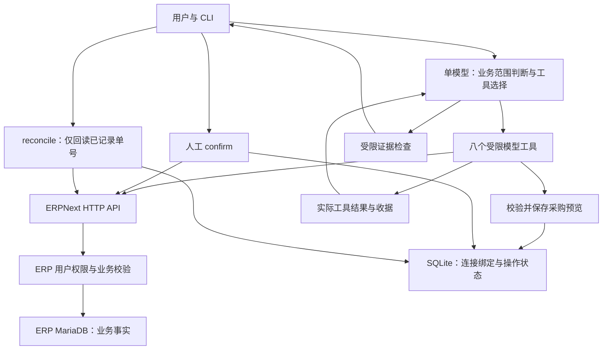

# 恢复、记忆、检索与租户：当前能力和下一步

本项目是单人使用的 ERPNext CLI Agent。当前实现了通用只读工具、多轮工具选择、人工采购确认、本地持久状态、防同一预览重复派发和有界的恢复核查。它没有应用登录、完整 SaaS 租户权限、持久聊天检查点、长期用户记忆或运行时多模型路由。新增组件应解决可测的问题，不能用组件数量代替可靠性。

后续HTTP安全阶段115项测试通过，见`evidence/unit_security.txt`和[SECURITY_AND_DEPLOYMENT](SECURITY_AND_DEPLOYMENT.md)。注册表阶段128项，API效率阶段当前149项，见[TOOL_REGISTRY](TOOL_REGISTRY.md)和[API_EFFICIENCY](API_EFFICIENCY.md)；下文104项是恢复阶段记录，未改写原输出。

## 当前运行架构



模型不能调用确认、通用创建、SQL 或 Shell；写入只能来自 CLI 的人工确认。模型 messages 和上轮 trace 在进程内存中；SQLite 只保存采购操作状态。验收脚本输出的 JSON 是审计记录，不能当作自动恢复的工作流检查点。

## 断线后按什么顺序恢复

不是固定地“先数据库，再所有记忆，再所有工具”。应先确定当前连接身份，再读该操作的持久状态，根据远端副作用是否可能发生决定下一步：

1. 确认当前 ERP 地址、凭据配置和 proposal ID；其他连接及未绑定旧记录不能参与恢复。
2. 读取 SQLite 中的不可变载荷、状态、时间和已知远端单号。聊天里一句“成功了”不能覆盖操作记录。
3. 如果已有远端单号，读 ERP 原单核对身份、明细、金额、日期、币种和 docstatus；ERP 现状是业务事实来源。
4. 比较本地状态和单号仍未变化后，原子保存核查结果，避免覆盖并发完成者。
5. 最后生成用户说明。历史对话只能提供意图背景，不能证明订单是否已经创建。

| 中断位置 | 当前保存状态 | 当前恢复行为 |
|---|---|---|
| 确认前复验主数据 GET 失败 | pending | 网络恢复后可重新确认；仍受 15 分钟有效期约束 |
| 已原子领取，尚未发出 POST 时崩溃 | creating，可能无单号 | 阻止重发；虽然可能尚未创建，也不能仅凭本机状态证明未发出 |
| POST 已提交但响应丢失 | creating 或 failed，可能无单号 | 阻止同 ID 再次创建；人工检查 ERP，不把相似单据当唯一证明 |
| 收到单号后崩溃或 GET 失败 | creating/failed，created_name 已保存 | 重启后 `/reconcile id`，只 GET 原单，绝不 POST |
| GET 返回字段漂移或已经提交/取消 | completed，result.review_required=true | 创建流程已结束，但结果必须人工复核；不宣称是合格草稿，不修改远端 |
| GET 核查成功并已落库 | completed，result 已保存 | 阻止重复确认；可从结果或 ERP 查看单号。当前 reconcile 仅接受未解决的 creating/failed |

`/reconcile` 对 ERP 只读，但会更新本地状态和核查结果。404、权限错误、超时及坏回包继续保留 failed 和已知单号，不回到 pending。过期预览不能再确认，但已发生创建的单据仍可核查。名称或 DocType 不匹配同样进入差异清单，要求人工复核。

当前没有自动重试网络层、指数退避、熔断、任意工具节点续跑或持久聊天恢复。只读工具错误会进入模型工具结果，模型可修正查询；模型请求失败则该轮历史不提交，最近 trace 留在内存供查看。重新启动会丢失这部分内存。采购状态独立保存，不随 `/reset` 删除。

## 幂等键到底有没有

有本地 proposal ID 和 SQLite 原子领取：`BEGIN IMMEDIATE` 将 pending 改成 creating 并提交后，才发创建请求。同一本地日志中的同一 ID 只有一次派发机会。新增状态/单号比较更新，防止迟到失败把已完成结果覆盖掉。

**没有 ERP 服务端的业务幂等键。** 新建一个 proposal、换日志文件或换机器，仍可能表达同一采购意图。因此不能称“全局幂等”或“端到端恰好一次”。未知单号时禁止盲重发，是用可用性换取避免重复采购。

若升级为生产服务，正确方向是在 ERP 服务端增加受权限控制的创建适配：

- 由可信服务生成并持久化 `(tenant, business_request_id)`，同键同时保存载荷 hash。
- 在创建订单的同一数据库事务里，登记具有唯一约束的请求键、订单名和结果。
- 相同键、相同载荷重试返回同一结果；同键不同载荷拒绝。超时后能按键查询结果。
- 队列或 outbox 在确需异步跨系统派发时再增加；消费者仍须幂等。锁和聊天检查点不能替代 ERP 内的原子约束。

这些需要 ERP 服务端扩展；当前没有为了演示而修改题目备份或假装 HTTP 请求头已具备该保证。

## SQLite 专业吗，需不需要 Milvus

ERP 业务数据仍在 MariaDB；SQLite 是本机操作日志，承担事务与防重状态。它适合这种短事务、低写并发的嵌入式用途。SQLite 每库同一时刻只有一个写者，集中式多实例、高写并发服务应评估 PostgreSQL 等服务端数据库。[SQLite 官方适用场景](https://www.sqlite.org/whentouse.html)

Milvus 用于向量及全文/混合召回，适合未来的产品说明书、SOP、别名或大量历史案例。它不能解决创建请求丢响应、订单事务、幂等或权限问题。当前作业主要依赖结构化实时单据，没有证据表明需要部署 Milvus。[Milvus 全文检索](https://milvus.io/docs/full-text-search.md)、[混合检索](https://milvus.io/docs/multi-vector-search.md)

如果以后接入文档检索，先评估语料规模、关键词基线和召回质量，再选择向量存储；召回结果只提供候选/说明。库存、欠款和完整统计仍必须回 ERP 按精确身份核验，不能把向量 top-k 当完整账本。

## “四种记忆”应该如何理解

短期/长期主要是持续时间与作用域；语义事实、情景经验、流程规则描述内容；用户画像又是事实组织的一种形式。这些维度有重叠，并非必须部署四套记忆库。[LangChain 记忆概念](https://docs.langchain.com/oss/python/concepts/memory)

| 用户关心的记忆 | 当前实际能力 | 合理的后续方式 |
|---|---|---|
| 短期 | 当前会话 messages；失败轮不提交 | 按连接/用户/会话保存检查点；设置上下文预算，压缩时保留证据 ID、未解决问题与确认状态 |
| 长期 | 没有自动跨会话知识记忆 | 只保存用户明确允许的稳定偏好；有来源、版本、有效期、删除接口和隔离 |
| 流程 | 系统规则、工具约束、采购状态机 | 版本化 SOP 和适配器，由程序执行关键检查；模型不能自行改写权限/确认规则 |
| 情景/经验 | 验收 JSON 和本地操作记录可人工审查；没有运行时相似案例召回 | 从已核验轨迹提炼案例，分离成功/失败原因，评估召回是否提升新任务表现 |
| 用户画像 | 没有 | 明确用户身份后存语言、显示单位等偏好；公司权限和额度来自授权系统，不能靠画像推断 |

记忆里的旧库存、价格、欠款均不是当前业务事实。下次回答仍应查询 ERP。把日志保存下来，也不等于 Agent 已能理解并检索经验。

## 意图识别与大小模型路由

当前同一强模型根据系统规则判断业务范围并选择工具。新增的软规则要求：纯吃饭/天气问题简短引导回业务，不查询 ERP；混合问题处理其中的 ERP 部分；不因遇到未见 DocType 就拒绝。S01/S02/S03 是开发定向实测，不是经过校准的独立意图分类器。软提示不承担安全授权，写入权限始终由程序和 ERP 控制。

如果后续业务量要求独立路由，可输出 `business_read / business_write / clarify / out_of_scope` 的结构化标签，低确定性进入澄清或强模型。必须评估混合、歧义、未知单据、中文口语和误拒业务的比例。

小模型拦截、中模型编排、大模型兜底是一种可评估的部署策略，并非必要的三层标准。增加前置调用也会增加延迟与误分类链条。当前以正确性优先，保留一个强模型更容易验证；应有独立质量/延迟评估后再路由。供应商切换或模型降级不得触发采购 POST 自动重放。[Anthropic 的工作流与路由讨论](https://www.anthropic.com/engineering/building-effective-agents)

## 查询是 HTTP，是否太简单

客户API不能频繁调用时，现已加入客户端精确请求复用、元数据TTL、来源时间、HTTP调用预算/节流，以及候选列表省略总数。已有证据用于本地计算；不将未知值推断成事实。完整聚合、采购校验与回读绕过缓存，默认值和真实1→0→0请求证据见[API_EFFICIENCY](API_EFFICIENCY.md)。

传输是 HTTP，查询能力由 ERP API、过滤、元数据和工具组合提供。当前模型生成 JSON 工具参数，执行器按白名单读取；底层不让模型直连 SQL。ERP API 使用令牌所属用户的权限。[Frappe REST API](https://docs.frappe.io/framework/user/en/api/rest)

目前支持精确/like/in 等过滤、元数据发现、父单及子表读取、最多20名称的批量、完整有界聚合和 Decimal 算术。自然语言匹配由模型生成候选查询；没有 embedding 语义索引、全库混合检索或任意多表 SQL 引擎。关键词命中不能证明找到了某业务类别的全部成员。

真实检查已经发现并修复一个典型坑：子表过滤使同一发票因两条明细返回两次，原始计数2不等于两张发票。工具按父 name 计1、父金额USD6600仅加一次，同时保留原始分页offset。这种粒度与完整性检查比换成向量库更直接影响当前任务正确性。

让模型生成 `grep`、SQL 或 Python 并不会自然提高可靠性。grep 适合文本文件；ERP 应优先使用受权限控制的结构化接口。未来确需生成代码时，须另设只读沙箱、资源上限和审计，不能直接复用采购写入权限。

## JSON 任务清单、候选打分与阈值

当前已经是逐步 JSON tool call → 真正执行 → 工具结果 → 下一步选择，但没有完整的持久任务 DAG 或通用候选评分器。复杂任务可以扩展成结构化计划，至少包含：

```json
{
  "intent": "business_read",
  "entities": [],
  "metrics": [],
  "date_basis": "explicit reference date",
  "currency_and_uom": [],
  "steps": [{"tool": "allowed_tool", "arguments": {}, "depends_on": []}],
  "evidence_ids": [],
  "coverage": "unknown",
  "missing_information": []
}
```

这是后续设计示意，当前不会自动生成/持久化该清单。可让模型提出候选并解释证据，但身份匹配、单位币种一致、分页完整、权限和人工确认必须由程序检查。模型自报0.95分不构成证据，也不能解锁写入。候选阈值要用独立验证集校准，低分/近似并列应澄清；不能靠一个未经验证的固定阈值保证正确。

## 租户隔离的边界

Frappe 的租户单位是 Site，每个 Site 有独立数据库；同一 Site 的不同 Company 不自动构成租户隔离。[Frappe Sites](https://docs.frappe.io/framework/user/en/basics/sites)

本轮修复连接配置隔离：地址规范化 + 凭据指纹绑定预览；加载、pending、按ID查询、确认、丢弃和恢复都按绑定过滤；SQLite 修改事务内再核对作用域。其他连接、未绑定旧记录、未知ID统一拒绝。换密钥也会换作用域，旧预览需重建；没有隐式迁移。

这仍不是 SaaS 鉴权：没有应用用户、租户RBAC、行级安全或文件权限隔离；同一OS用户能直接读SQLite。当前seed管理员仅适用于作业环境。生产化需可信登录身份选择Site/最小权限ERP用户，并将会话、操作、缓存、日志和检索索引全部绑定 tenant/user/session。租户不能从模型生成的JSON自由选择。至少测试A不能读取、确认、丢弃或恢复B的对象。

## 已验证与优先级

本轮完整代码测试104项通过，见 `evidence/unit_recovery.txt`；真实REST19项再次通过。覆盖丢响应、已知单号回读失败、重启、并发状态比较、外部漂移及连接配置隔离；它们不是负载压测或任意事实正确性证明。

软范围路由3题核心通过；完整回答2通过1部分：混合题正确查Item18，但多加“含草稿与已提交”没有核实状态依据。保留该瑕疵，不将工具成功当整段正确。外币H08定向完整通过；都不混入独立十题基线。

`evidence/recovery_live.json` 用真实旧回执创建了**临时测试副本**，显式赋当前连接绑定、设failed后GET既有00029，核查无差异并记completed；ERP创建方法被断言禁用，采购名称29→29。原回执是未绑定旧格式，未迁移或修改原日志；本次不是实际断网实验。代码测试另验证旧未绑定记录在正常运行时被拒绝。

当前有限制单页100、批量20、聚合原始行10000、模型16轮、ERP/模型超时，以及ERP每问/滚动分钟请求预算和间隔；没有连接池、并发批量、完整链路总时限或P95负载指标。多轮复杂查询耗时可到数十秒。下一步按收益排序是服务端幂等与未知结果对账、持久会话和上下文预算、更多独立变式评估、最小权限部署；只有语料需求成立后再加混合检索或Milvus。
